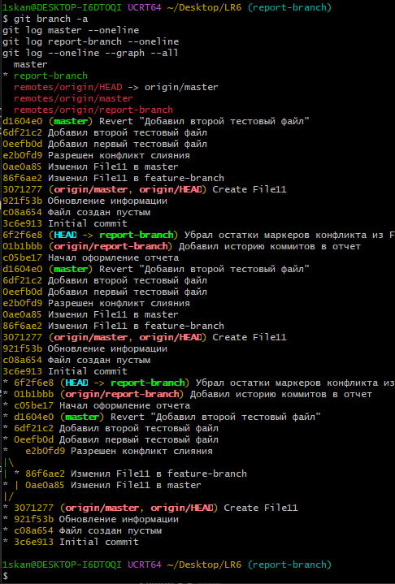
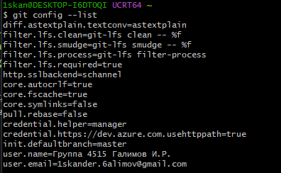
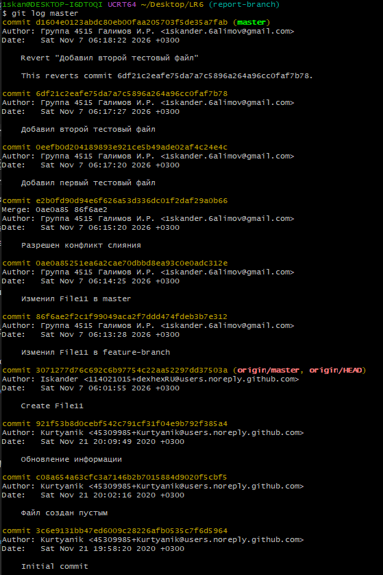
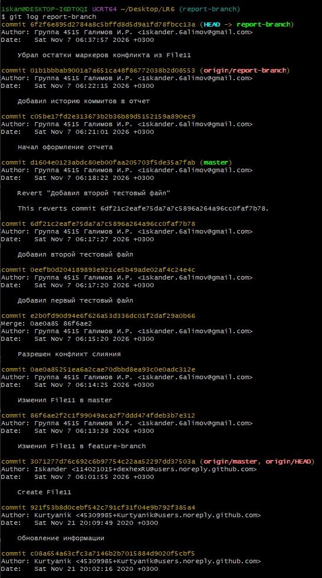
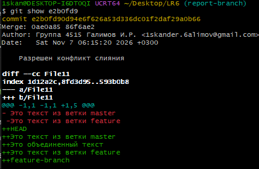
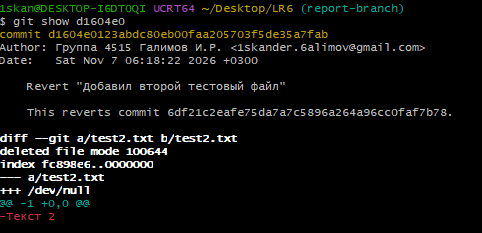

# Лабораторная работа №6
## Выполнил: Галимов И.Р.
## Лог команд
```
git config --global user.name "Группа 4515 Галимов И.Р."
git config --global user.email "iskander.6alimov@gmail.com"
git config --global --list
cd C:/Users/iskan/Desktop
git clone https://github.com/dexhexRU/LR6.git
cd LR6
git pull
git checkout -b feature-branch
git log --oneline
git log --all --oneline --graph --decorate
git branch
notepad File11
git add File11
git commit -m "Изменил File11 в feature-branch"
git checkout master
notepad File11
git add File11
git commit -m "Изменил File11 в master"
git merge feature-branch
notepad File11
git add File11
git commit -m "Разрешен конфликт слияния"
git branch -d feature-branch
echo "Текст 1" > test1.txt
git add .
git commit -m "Добавил первый тестовый файл"
echo "Текст 2" > test2.txt
git add .
git commit -m "Добавил второй тестовый файл"
git revert HEAD
git checkout -b report-branch
notepad README.md
git add README.md
git commit -m "Начал оформление отчета"
git log --pretty=format:"%h - %ad - %an - %s" --date=short
notepad README.md
git add README.md
git commit -m "Добавил историю коммитов в отчет"
git push -u origin report-branch
git checkout report-branch
git pull origin report-branch
notepad File11
git add File11
git commit -m "Убрал остатки маркеров конфликта из File11"
git branch -a
git log master --oneline
git log report-branch --oneline
git log --oneline --graph --all
mkdir img
git log HEAD
git log master
git log report-branch
git checkout master
git pull origin master
git merge report-branch
git push origin master
git checkout report-branch
git --no-pager log --oneline --graph --all
git add img
git commit -m "Добавил скриншоты в папку img"
git push origin report-branch
git show e2b0fd9
git show d1604e0
git add img
git commit -m "Добавил скриншоты git show для слияния и отката"
git push origin report-branch
git add README.md
git commit -m "Добавил скриншоты и лог команд в отчет"
git push origin report-branch
```

## Скриншоты
### Настройка git


### Ветки и история


### История ветки master


### История ветки report-branch


### Слияние с разрешённым конфликтом


### Откат коммита

